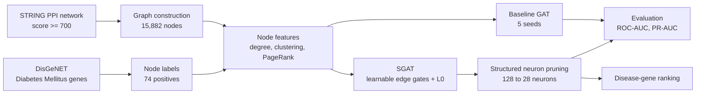
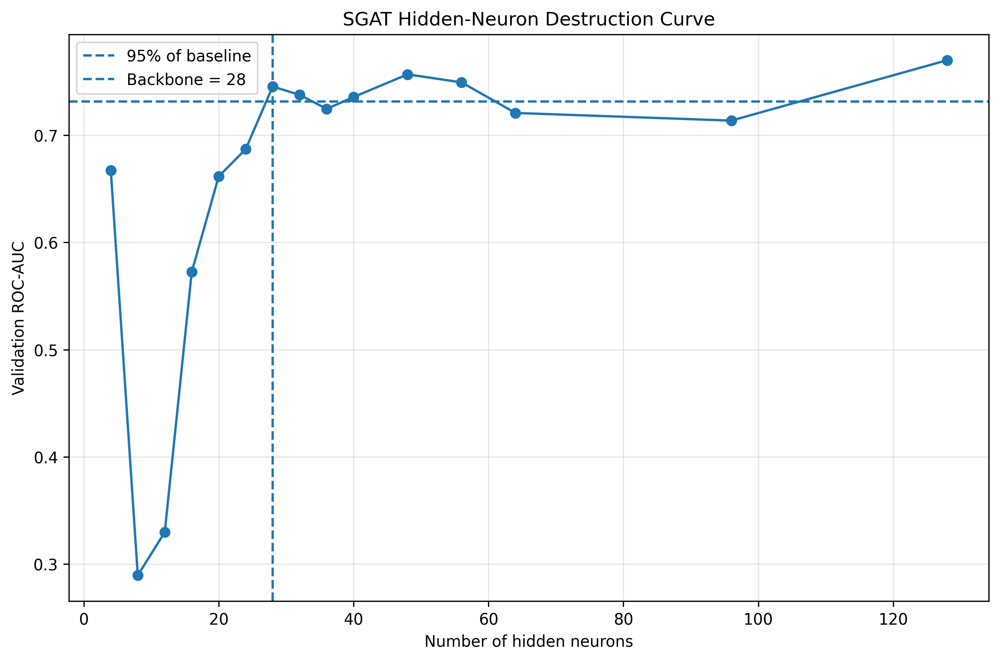
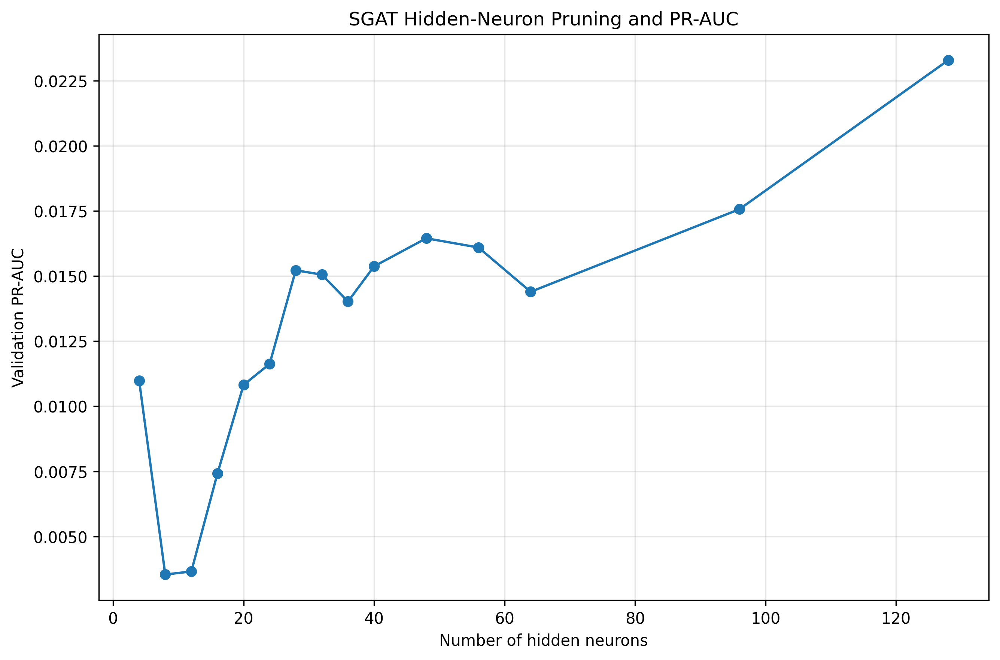

<div align="center">

# GNN-Based Drug Target Identification

### Sparse Graph Attention and Structured Neuron Pruning for Disease Gene Classification

*Master's Research Project in Artificial Intelligence and Emerging Technologies (MIATE)*
*Faculty of Applied Sciences, Nador - Mohammed First University*

<br/>


</div>

---

## Table of Contents

- [1. Project Overview](#1-project-overview)
- [2. Key Results](#2-key-results)
- [3. Methodology](#3-methodology)
- [4. Data Splitting Strategy](#4-data-splitting-strategy)
- [5. Results Visualization](#5-results-visualization)
- [6. Repository Structure](#6-repository-structure)
- [7. Installation and Execution](#7-installation-and-execution)
- [8. Dataset Sources](#8-dataset-sources)
- [9. Limitations](#9-limitations)
- [10. Citation](#10-citation)
- [11. Acknowledgments](#11-acknowledgments)
- [12. Authors](#12-authors)

---

## 1. Project Overview

This repository contains the complete implementation of our research on **Graph Neural Networks (GNNs) for disease-gene classification** on a human protein-protein interaction (PPI) network, with **Diabetes Mellitus** as the target disease.

The study addresses a typical problem in computational drug discovery: identifying candidate disease genes in a large biological network where known positive examples are extremely rare (0.47% of nodes). It compares a standard Graph Attention Network (GAT) with a sparse variant (SGAT) that learns which edges to keep, then compresses the model through structured neuron pruning.

The entire pipeline (data preprocessing, GAT baseline, SGAT sparse training, structured neuron pruning, and disease-gene ranking) is implemented in a **single Jupyter notebook**: [`gnn_drug_target_identification.ipynb`](gnn_drug_target_identification.ipynb).



---

## 2. Key Results

| Model | Neurons | Test ROC-AUC | Test PR-AUC | Edge Sparsity |
|---|---|---|---|---|
| Baseline GAT (5 seeds) | 128 | 0.6860 ± 0.0601 | 0.0093 ± 0.0020 | 0% |
| SGAT | 128 | 0.6817 | 0.0167 | 71.48% |
| SGAT compact backbone | 28 | 0.7140 | 0.0142 | 71.48% |

<div align="center">


</div>

The compact model reduces the hidden representation by **78.12%** (128 to 28 neurons) while retaining the learned **71.48%** edge sparsity.

---

## 3. Methodology

| Step | Stage | Description |
|---|---|---|
| 1 | **Graph construction** | STRING high-confidence interactions (combined score >= 700): 15,882 nodes and 236,712 undirected edges. |
| 2 | **Disease labels** | DisGeNET Diabetes Mellitus genes: 74 mapped positive nodes versus 15,808 negative nodes (0.47% prevalence). |
| 3 | **Node features** | Degree, clustering coefficient, and PageRank. |
| 4 | **Baseline GAT** | Two-layer graph attention network, evaluated across 5 random seeds. |
| 5 | **SGAT adaptation** | Learnable edge gates with L0 sparsity regularization (lambda = 1e-6). |
| 6 | **Structured neuron pruning** | Importance ranking of the 128 hidden neurons; the smallest representation satisfying a 95% validation ROC-AUC retention criterion contains 28 neurons. |
| 7 | **Disease-gene ranking** | Computational prioritization of candidate genes (EGFR, CTNNB1, TP53, among others); known genes FN1, RAC1, and INS are recovered in the top 30. |

### Model Architecture

<div align="center">


</div>

---

## 4. Data Splitting Strategy

<div align="center">


</div>

A stratified 60/20/20 split (seed 42) preserves the class ratio across subsets:

| Subset | Nodes | Positive examples |
|---|---|---|
| Train | 9,529 | 44 |
| Validation | 3,176 | 15 |
| Test | 3,177 | 15 |

---

## 5. Results Visualization

### Neuron Destruction Curve (Validation ROC-AUC)

<div align="center">



</div>

The 28-neuron configuration is the smallest tested representation that satisfies the 95% validation ROC-AUC retention threshold (0.7315).

### Neuron Pruning Curve (PR-AUC)

<div align="center">



</div>

---

## 6. Repository Structure

```text
gnn-drug-target-identification/
│
│
│── data_split.jfif                          # Data splitting visualization
├── model_architecture.jfif                  # Model architecture diagram
│
├
├── sgat_neuron_destruction_roc_auc.png  # Neuron destruction curve (ROC-AUC)
│── sgat_neuron_pruning_pr_auc.png       # Neuron pruning curve (PR-AUC)│
│── .gitignore
├── gnn_drug_target_identification.ipynb     # Complete pipeline (single notebook)
├── README.md
└── requirements.txt
```

**Note:** The `data/` folder is not included in the repository due to file size limitations. Download the datasets separately using the links provided in the [Dataset Sources](#8-dataset-sources) section.

---

## 7. Installation and Execution

### Prerequisites

- Python 3.8 or higher
- Jupyter Notebook
- Dependencies listed in `requirements.txt`

### Setup

```bash
git clone https://github.com/mohammed-boujaada/gnn-drug-target-identification.git
cd gnn-drug-target-identification

python -m venv venv
source venv/bin/activate        # Windows: venv\Scripts\activate
pip install -r requirements.txt
```

### Download Datasets

Create a `data/` folder and download the required datasets (see [Dataset Sources](#8-dataset-sources) below).

### Run the Pipeline

```bash
jupyter notebook
```

Open `gnn_drug_target_identification.ipynb` and execute the cells in order. The notebook performs the following steps sequentially:

1. Graph construction and label mapping
2. Node feature computation
3. GAT baseline (5 seeds)
4. SGAT training with learnable edge gates
5. Sparsity analysis
6. Structured neuron pruning
7. Final disease-gene ranking

---

## 8. Dataset Sources

### Download Link

📥 **[Download all datasets here](https://www.kaggle.com/datasets)** *(or replace with your actual Kaggle/Google Drive link)*

Alternatively, download each dataset separately:

| Dataset | Version | Used for | Link |
|---|---|---|---|
| **STRING** | v12.0 (Homo sapiens, taxon 9606) | Protein information and interactions, filtered at combined score >= 700 | [string-db.org](https://string-db.org/cgi/download.pl?species_text=Homo+sapiens) |
| **DisGeNET** | Curated gene-disease associations | Diabetes Mellitus gene associations (91 genes, 74 mapped to the PPI graph) | [disgenet.org](https://www.disgenet.org/downloads) |

**Instructions:**
1. Create a folder named `data/` in the root directory
2. Download the STRING files for Homo sapiens (taxon 9606):
   - `9606.protein.info.v12.0.txt`
   - `9606.protein.links.v12.0.txt`
3. Download the DisGeNET curated gene-disease associations:
   - `curated_gene_disease_associations.tsv`
4. Place all three files in the `data/` folder

---

## 9. Limitations

- Strong class imbalance (0.47% positive nodes): evaluation relies on ROC-AUC and PR-AUC rather than accuracy.
- Topology-based features only; no sequence, expression, or pathway information is used.
- 17 DisGeNET genes could not be mapped to the PPI graph.
- Negative labels do not prove biological irrelevance to the disease.
- The gene ranking provides computational hypotheses, not validated drug targets.

---

## 10. Citation

```bibtex
@mastersthesis{zahir2026gnn,
  title  = {GNN-Based Drug Target Identification: Sparse Graph Attention
            and Structured Neuron Pruning for Disease Gene Classification},
  author = {Zahir, Mohamed and Boujaada, Mohammed},
  school = {FSA Nador, Universit\'e Mohammed Premier},
  year   = {2026}
}
```

---

## 11. Acknowledgments

The authors thank Prof. Khalid El Makkaoui and Prof. Ibrahim Ouahbi for their coordination and academic support, and Prof. Jamal Boussouf for his mentorship, guidance, and valuable feedback throughout this work.

---

## 12. Authors

<div align="center">

<table>
<tr>
<td align="center" width="260">
<a href="https://github.com/mohammed-boujaada">

<br/>
<sub><b>Mohammed Boujaada</b></sub>
</a>
<br/>
MIATE Master's, FSA Nador
<br/><br/>
<a href="https://github.com/mohammed-boujaada">

</a>
<br/>
<a href="https://www.linkedin.com/in/mohammed-boujaada-229a3333a/">

</a>
</td>
<td align="center" width="260">
<a href="https://github.com/moza369">

<br/>
<sub><b>Mohamed Zahir</b></sub>
</a>
<br/>
MIATE Master's, FSA Nador
<br/><br/>
<a href="https://github.com/moza369">

</a>
</td>
</tr>
</table>

<br/>


</div>
